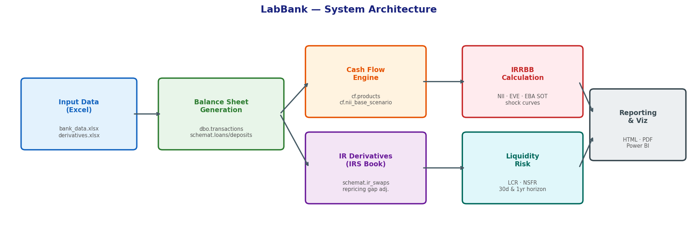
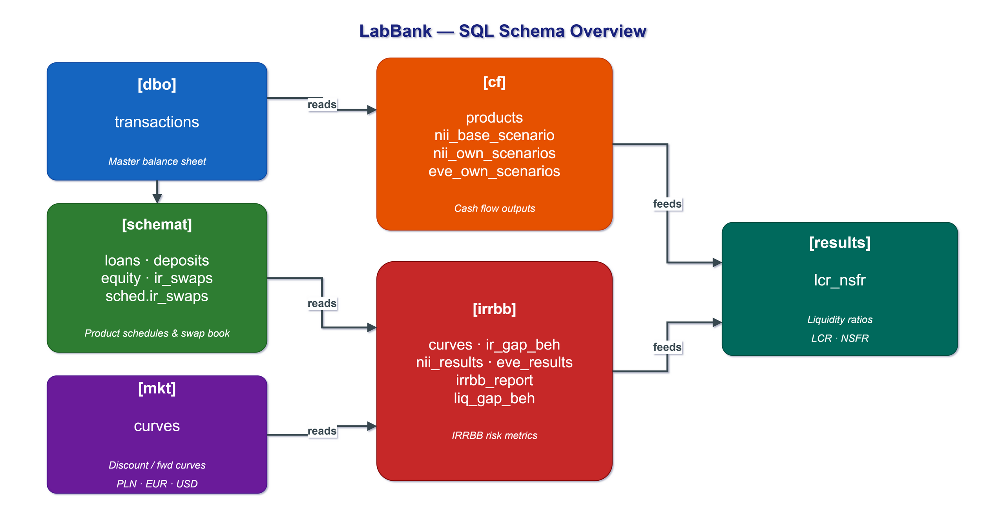

# LabBank

LabBank is a laboratory banking ALM system that connects risk methodology with a working data engineering stack. It generates a synthetic bank balance sheet, enriches it with market and behavioural assumptions, produces contractual and behavioural cash flows, and calculates IRRBB and liquidity metrics from the same auditable data foundation.

The project is designed for people who sit between ALM, risk analytics, finance, data engineering, and reporting. It is not a toy notebook and it is not a closed black-box model. The goal is to make the full ALM chain visible: from transaction-level inputs, through SQL-backed cash flows, to regulatory-style outputs and reporting.

## Quick start: two ways to use this project

**A) LabBank only — no SQL Server, no setup beyond Python.** Explore a pre-built synthetic bank's NII, EVE, EBA SOT, LCR, and NSFR interactively, stress the balance sheet, IRS book, and NMD behavioural assumptions, and see the impact in real time.

```powershell
python -m venv venv
.\venv\Scripts\Activate.ps1
pip install -r requirements.txt
streamlit run sandbox\app.py
```

This is the fastest path to see what the project does. LabBank reads only local files (the demo pack in `demo/pln/`, unpacked into `runs/pln/` on first start, `inputs/pln/balance/bank_data.xlsx`, and a few other Excel inputs) — nothing here touches a database.

**B) Full ETL pipeline with SQL Server — generate your own balance sheet.** If you want to build a balance sheet from your own numbers (not just stress the shipped demo one), you'll need SQL Server as the integration/audit layer — see [Setup](#setup) below. Once it's running:

1. Edit `inputs/pln/balance/bank_data.xlsx` (and `inputs/pln/derivatives/derivatives.xlsx` for swaps) with your own data.
2. Run the `labbank_data_job` in Dagster (`.\dagster_pipeline\start_dagster.ps1`, then launch this job) — it regenerates the full balance sheet, recomputes IRRBB/liquidity, and rebuilds the npz tensors LabBank reads, all in one step.
3. In the already-running Streamlit app, click **"🔄 Reload my data"** in the sidebar — LabBank now shows your balance sheet instead of the shipped demo one.

Path A and B share the same LabBank app; B just changes what data it's pointed at.

## What the project demonstrates

- End-to-end balance sheet generation for loans, deposits, financial instruments (including a T-bill product covering the HQLA short end), equity, cash accounts, and interest rate swaps.
- Cash-flow engine with contractual schedules and behavioural assumptions such as loan prepayment and non-maturity deposit decay.
- IRRBB calculations for NII, EVE, and EBA Supervisory Outlier Test scenarios.
- Liquidity risk calculations for LCR and NSFR.
- SQL Server as the integration and audit layer between modules.
- Dagster orchestration for reproducible pipeline runs and business-case jobs.
- Reporting through Excel, Jupyter/HTML, and Beamer assets.
- Optimisation preparation layer with vectorised tensors (the fast layer LabBank and the optimiser read).
- One-year roll-forward of the EUR bank: every contract aged one year, new business to a growth plan, planned swaps added (`eur` -> `eur_y1`).
- Joint balance-sheet + swap optimisation: the mix and new pay-fixed swaps that maximise economic profit inside the EVE/NII risk appetite, checked on the full engine and on Monte Carlo curves.

## Project idea

A bank balance sheet produces many future cash flows. ALM metrics such as NII, EVE, LCR, and NSFR should be calculated from a consistent source, otherwise reconciliation becomes the hardest part of the process.

LabBank follows one core principle:

> Every number in the final reports should trace back to transaction-level data and cash-flow rows stored in SQL.

This makes the project useful both as an ALM methodology sandbox and as a technical reference architecture for Python + SQL Server + Dagster based analytical pipelines.

## Visual overview





## Documentation

- [`docs/01_setup_guide.md`](docs/01_setup_guide.md) — installing and running both quick-start paths.
- [`docs/02_methodology.md`](docs/02_methodology.md) — the ALM/IRRBB/liquidity methodology behind the calculations.
- [`docs/release_notes_2026-11.md`](docs/release_notes_2026-11.md) — what this release contains and how to run the EUR bank, the roll-forward and the optimisation.
- [`docs/03_technical_notes.md`](docs/03_technical_notes.md) — a code-level companion covering key classes/functions per module, design decisions, and known limitations.

## Functional modules

| Area | Folder | Main responsibility |
| --- | --- | --- |
| Balance sheet generation | `balance_generate/` | Creates synthetic transactions and product-level balance sheet tables. |
| Market and behavioural enrichment | `balance_gen_add_data/` | Loads curves, fixings, schedules, and behavioural model parameters. |
| Cash-flow engine | `cash_flow_calc/` | Produces contractual and behavioural cash-flow schedules and repricing/liquidity gaps. |
| Interest rate derivatives | `ir_derivatives/` | Loads IRS positions, creates swap cash flows, and overlays the repricing gap. |
| IRRBB | `irrbb_calc/` | Calculates NII, EVE, EBA shock scenarios, and Supervisory Outlier Test outputs. |
| Liquidity risk | `liq_calc/` | Calculates LCR and NSFR from balance sheet and cash-flow data. |
| Optimisation preparation | `optimize_prep/` | Builds the fast approximation tensors LabBank reads, plus accuracy checks against the exact pipeline. |
| Interactive exploration (LabBank) | `sandbox/` | Streamlit app — stress the balance sheet, IRS book, and NMD assumptions and see NII/EVE/SOT/LCR/NSFR update live. No SQL Server required. |
| Orchestration | `dagster_pipeline/` | Defines Dagster assets and jobs over the workflow scripts. |
| Reporting | `visual_rep/` | Contains notebooks, HTML reports, Beamer presentation, and chart assets. |
| Documentation | `docs/` | Setup guide and ALM/architecture methodology write-ups — see [Documentation](#documentation) below. |
| Roll-forward | `balance_generate/python_code/b_s_rollforward.py` | Ages the EUR book one year and adds new business and planned swaps; the result is the bank `eur_y1`. |
| Balance sheet optimisation | `bs_optimization/` | Joint balance-sheet + swap optimiser under EVE/NII risk appetite, robust curves, Monte Carlo test — see "Optimisation preparation and balance sheet optimisation" below. |

## Pipeline flow

1. Generate synthetic balance sheet transactions from Excel inputs and product assumptions.
2. Load market data, historical fixings, behavioural assumptions, and schedule tables.
3. Generate contractual and behavioural cash flows for all products.
4. Add interest rate swap cash flows and merge the IRS gap into the IRRBB repricing gap.
5. Build EBA shock curves and calculate NII over the 1-year horizon.
6. Calculate EVE as the present value of run-off cash flows under base and shocked curves.
7. Apply EBA SOT logic, including conservative treatment of gains.
8. Calculate LCR and NSFR.
9. Export Excel, notebook, HTML, and Beamer reporting outputs.

## ALM and risk methodology

### IRRBB

The IRRBB layer calculates:

- NII under base and shocked scenarios.
- EVE under run-off assumptions.
- EBA shock scenarios, including parallel up/down, steepener, flattener, short-rate up/down, and an own scenario.
- Supervisory Outlier Test outputs versus Tier 1 capital.
- Repricing gap effects before and after the IRS overlay.

The implementation separates the economic logic from the orchestration layer. Workflow scripts perform the calculations; Dagster wraps those scripts as assets so the pipeline can be rerun by business use case.

### Liquidity

The liquidity layer calculates:

- LCR as high-quality liquid assets divided by stressed 30-day net outflows.
- NSFR as available stable funding divided by required stable funding.
- Behavioural liquidity gaps using cash-flow schedules, prepayment, and deposit decay assumptions.

### Behavioural modelling

The project includes behavioural assumptions used in ALM practice:

- Loan prepayment assumptions.
- Early redemption of retail fixed-rate term deposits (baseline cumulative redemption rate per product).
- Scenario-dependent behaviour per EBA RTS 2024/857: in each shock scenario the prepayment rate of retail fixed-rate loans is multiplied by 0.8 (rates up, steepener) or 1.2 (rates down, flattener) (Art. 9(3)), and the term-deposit redemption rate by 1.2 (short rates up) or 0.8 (short rates down) (Art. 10(5)). The cash-flow engine always stores both variants in `cf.products_scen`; whether EVE, NII and SOT use them (and whether term deposits carry the baseline early redemption) is controlled by `APPLY_EBA_BEHAVIOUR` in `labbank_common/irrbb_behaviour.py` — off by default; after switching, rerun from the cash-flow step.
- Non-maturity deposit decay for interest-rate and liquidity views.
- Product-level repricing logic.
- Fixed and floating rate product treatment.
- Interest rate swap overlay without changing the underlying balance sheet.

## Data model

SQL Server is used as the central integration layer. The modules write to dedicated schemas, including balance sheet, market data, schedules, cash flows, IRRBB, optimisation preparation, and result tables.

The important design choice is that downstream modules read from upstream SQL tables instead of passing hidden in-memory state. This makes runs easier to audit, rerun, and inspect.

The pipeline writes across nine schemas:

| Schema | Purpose | Example tables |
| --- | --- | --- |
| `dbo` | Landing zone for generated transactions | `transactions` |
| `schemat` | Product-level balance sheet | `loans`, `deposits`, `financial_instruments`, `equity`, `ir_swaps` |
| `mkt` | Market data | `curves`, `fixings` |
| `bs` | Behavioural model parameters | `models_loan`, `models_deposit_ir`, `models_deposit_liq`, `models_deposit_tdrr`, `models_rate` |
| `sched` | Schedule/leg-level detail | `ir_swaps` (swap leg schedules) |
| `cf` | Cash-flow engine output | `products`, `products_liq`, `products_scen` (EBA scenario variants of prepayment / early-redemption schedules), `ir_swap_orig`, `ir_swap_beh`, plus the per-scenario-group analytical tables (`eve_*_scenarios`, `nii_*_scenarios`) |
| `irrbb` | IRRBB calculation results | `ir_gap_orig`, `ir_gap_beh`, `ir_gap_beh_a`, `liq_gap_orig`, `liq_gap_beh`, `ir_swap_gap_beh`, `nii_results`, `eve_results`, `irrbb_report` |
| `results` | Final reporting tables | `irrbb_report`, `lcr_nsfr` |
| `opt_prep` | Fast-approximation tensors backing LabBank's sandbox | `monthly_curves`, `product_params`, `product_scenario_params` |

## Dagster orchestration

Dagster assets are defined in `dagster_pipeline/assets/`. The project includes several business-case jobs:

| Job | Purpose |
| --- | --- |
| `balance_sheet_job` | Generate the balance sheet, load enrichment data, and process IRS positions. |
| `full_run_job` | Run the complete ALM pipeline from balance sheet to IRRBB and liquidity outputs. |
| `irs_update_job` | Reload swaps and recompute IRRBB without rebuilding the balance sheet. |
| `irrbb_recalc_job` | Recompute NII, EVE, and SOT from existing cash flows after market curve changes. |
| `liq_only_job` | Refresh LCR and NSFR only. |
| `optimize_prep_job` | Rebuild fast approximation tensors and run accuracy checks. |
| `labbank_data_job` | Full pipeline + optimize_prep in one job. Run this after editing the input Excel files to regenerate your own balance sheet and refresh LabBank's data — see [Quick start, path B](#quick-start-two-ways-to-use-this-project). |

Run the Dagster UI from the repository root:

```powershell
.\dagster_pipeline\start_dagster.ps1
```

The Dagster module is configured in `pyproject.toml`:

```toml
[tool.dagster]
module_name = "dagster_pipeline.definitions"
```

## Technology stack

- Python
- Streamlit and Plotly (interactive LabBank sandbox)
- pandas, NumPy, SciPy
- SQLAlchemy and pyodbc
- SQL Server with Windows trusted authentication
- QuantLib
- Dagster
- Dask (optional distributed backend for large stress-test batches)
- Jupyter
- matplotlib
- Excel inputs and outputs
- LaTeX Beamer

## Setup

This section covers the full ETL pipeline (path B). If you only want to run LabBank against the shipped demo balance sheet (path A), you don't need any of this — just `pip install -r requirements.txt` and `streamlit run sandbox/app.py`.

Create and activate a Python environment:

```powershell
python -m venv venv
.\venv\Scripts\Activate.ps1
pip install -r requirements.txt
```

The pipeline uses SQL Server trusted authentication and one database per bank, e.g. for the PLN bank:

```text
mssql+pyodbc://localhost/bank_gen_pln?driver=ODBC+Driver+17+for+SQL+Server&Trusted_Connection=yes
```

Before running the pipeline on another machine, review `SqlCfg` in `labbank_common/bank_config.py` (the single place every module takes its engine from) and adjust:

- SQL Server name / instance.
- Database name.
- ODBC driver version.
- Authentication method.

## Multiple banks (PLN, EUR)

One codebase serves several banks, each with its own SQL database (`bank_gen_pln`, `bank_gen_eur`) and its own input/output folders (`inputs/<bank>/`, `runs/<bank>/<module>/`). Banks are defined in a single file, `labbank_common/bank_config.py`: PLN is the full definition, and EUR is `dataclasses.replace(PLN, ...)` listing only what differs (database, currency, floating index, report date, ...). Each bank has its own report date — PLN 2026-06-30, EUR 2026-09-30. Currency conventions (calendars, day counts, EBA shock sizes) stay keyed by currency where they are used.

The active bank is chosen by the `LABBANK_BANK` environment variable (default `eur`, the bank under active development; `LABBANK_BANK=pln` for the Polish bank). In Dagster every asset is partitioned by bank; the sandbox serves one bank per process (`streamlit run sandbox/app.py -- --bank pln` for the Polish bank).

## Running workflows directly

Most modules can be run as standalone workflow scripts, for example:

```powershell
python balance_generate\python_code\b_s_gen_workflow.py
python balance_gen_add_data\python_code\b_s_add_data_workflow.py
python cash_flow_calc\python_code\cf_calc_workflow.py
python ir_derivatives\python_code\swap_workflow.py
python irrbb_calc\python_code\nii_calc_workflow.py
python irrbb_calc\python_code\eve_calc_workflow.py
python irrbb_calc\python_code\eba_sot_workflow.py
python liq_calc\python_code\lcr_nsfr_workflow.py
```

For normal use, prefer Dagster because it preserves dependency order and gives a run history.

## Reporting outputs

The repository includes several reporting layers:

Every report is produced per bank into its own folder, so both banks' reports sit side by side and switching banks never means regenerating (`LABBANK_BANK` picks the bank, default `eur`):

| Report | Generator | Output |
|---|---|---|
| ALM & compliance | `python visual_rep/export_report.py` (template `visual_rep/ALM_report.ipynb`) | `runs/<bank>/visual_rep/ALM_report.ipynb` + `.html`/`.pdf` |
| Finance | `python visual_rep/make_finance_report.py` | `runs/<bank>/visual_rep/finance_report.ipynb` + `.html`/`.pdf` |
| Presentation charts | `python visual_rep/make_beamer_assets.py` | `runs/<bank>/visual_rep/beamer_assets/` (hand-made diagrams stay in `visual_rep/beamer_assets/`) |
| Optimisation runs | `python bs_optimization/python_code/reporting/btrm_article_runs.py` (see the release notes) | `runs/<bank>/bs_optimization/btrm_article_runs.json` |

- `visual_rep/labbank_presentation.tex` for the Beamer presentation.
- `runs/<bank>/irrbb_calc/*.xlsx` for IRRBB outputs.
- `runs/<bank>/liq_calc/lcr_nsfr_report.xlsx` for liquidity outputs.
- `runs/<bank>/optimize_prep/*.xlsx` and `*.npz` for optimisation preparation and accuracy checking.

## Optimisation preparation and balance sheet optimisation

The `optimize_prep/` module prepares vectorised data structures for fast metric approximation. It creates product parameter tensors and curve tensors, then checks approximate calculations against exact workflow outputs. These tensors are also exactly what LabBank (`sandbox/`) reads to run interactively without a database. `optimize_prep/` is fully public, part of this repo.

`bs_optimization/` builds on that layer with the joint balance-sheet + swap optimiser: for the EUR bank today (`eur`) and one year later (`eur_y1`) it chooses the balance-sheet mix and new par pay-fixed swaps that maximise economic profit inside the EVE and NII risk appetite, with business-line, growth and run-off limits. The limits also hold on alternative base curves; every result is re-priced on the full engine, and an out-of-sample Monte Carlo test (500 curves) gives the minimum new-swap notional per curve. How to run it: [`docs/release_notes_2026-11.md`](docs/release_notes_2026-11.md). It is not part of the guided LabBank path (A/B above).

## Repository status

This is a laboratory project, not production banking software. It is intended to show methodology, architecture, and implementation patterns for ALM analytics.

Some assumptions are intentionally simplified or synthetic:

- Input balance sheet data is generated for demonstration.
- Behavioural models are illustrative and should be calibrated before any real use.
- SQL connection settings are local and need adjustment per environment.
- Regulatory implementation should be independently validated before production use.

## Suggested next improvements

- Add an exported architecture PNG from the Draw.io source file.
- Move SQL connection settings to environment variables or a central config file.
- Reconcile the Quick Start section above with `docs/01_setup_guide.md` so the two don't drift out of sync.
- Expand tests beyond the fast-approximation layer (`optimize_prep/tests/`) to cover core IRRBB calculations.
- Add GitHub Actions checks for formatting and unit tests where SQL dependencies can be mocked.

## License and disclaimer

Licensed under the [MIT License](LICENSE).

This repository is an educational and analytical engineering project. It is not financial advice, not a regulatory submission engine, and not a production risk system without further validation, controls, documentation, and model governance.
