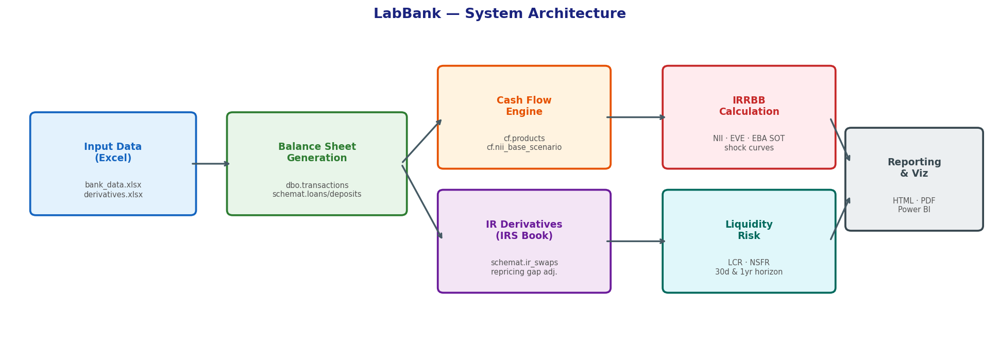

# LabBank — Setup Guide

This guide gets you running in one of two ways: exploring the shipped demo bank in LabBank with nothing but Python, or standing up the full SQL-Server-backed pipeline so you can generate and explore your own balance sheet. Pick the path that matches what you want to do — you can always start with Path A and move to Path B later.

## Who this is for

Practitioners, risk/ALM analysts, and students who want to see a complete ALM pipeline — from synthetic transaction generation through NII/EVE/EBA SOT/LCR/NSFR — and interact with the results rather than just read about them.



---

## Path A — LabBank only (no database, ~5 minutes)

Use this if you want to explore the ALM concepts and stress a pre-built balance sheet interactively. Nothing here touches SQL Server.

**Prerequisites:** Python 3.10 or later.

```bash
git clone <this-repo-url>
cd bank_project
python -m venv venv
```

Activate the environment:

```powershell
# Windows (PowerShell)
.\venv\Scripts\Activate.ps1
```
```bash
# macOS/Linux
source venv/bin/activate
```

Install and run:

```bash
pip install -r requirements.txt
streamlit run sandbox/app.py
```

Streamlit opens a browser tab at `http://localhost:8501`. You'll see six tabs: Balance Sheet, ALM Metrics, Gap Analysis, Market Curves, NMD Stress, and IRS Book. Everything is computed from files already checked into the repo (`runs/<bank>/optimize_prep/*.npz`, `inputs/pln/balance/bank_data.xlsx`, and a few supporting Excel files) — no database, no credentials, no orchestration engine involved.

**What to try first:** open the Balance Sheet tab, change a percentage in the "✏️ New %" column (both Assets and Liabilities+Equity must each sum to 100%), then check the ALM Metrics tab to see how NII, EVE, and the EBA Supervisory Outlier Test respond.

### Troubleshooting Path A

| Symptom | Likely cause / fix |
| --- | --- |
| `ModuleNotFoundError` on streamlit run | The venv isn't activated, or `pip install` didn't finish — re-run the two commands above. |
| Port 8501 already in use | Another Streamlit app is running. Run `streamlit run sandbox/app.py --server.port 8502` instead. |
| Charts look stale after editing files | Click **"🔄 Reload my data"** in the sidebar — the app caches loaded data and doesn't watch the filesystem for changes. |

---

## Path B — Full ETL pipeline with SQL Server (generate your own balance sheet)

Use this if you want to build a balance sheet from your own numbers rather than stress the shipped demo one. This path uses SQL Server as the integration/audit layer — every intermediate step (transactions, cash flows, IRRBB results) lands in a real database you can query directly, which is deliberate: being able to run your own SELECTs and aggregations against the data is part of the point, not just a means to an end.

### 1. Install SQL Server and the ODBC driver

Any edition works — **SQL Server Developer Edition** is free and full-featured, or use **SQL Server Express** for a lighter footprint. You also need the **ODBC Driver 17 for SQL Server** (or adjust the driver string in step 3 if you install a different version).

Create one empty database per bank — `bank_gen_pln` for the PLN bank (and `bank_gen_eur` if you also want the EUR bank). Any tool works — SSMS, Azure Data Studio, or `sqlcmd`:

```sql
CREATE DATABASE bank_gen_pln;
CREATE DATABASE bank_gen_eur;   -- optional, only for the EUR bank
```

You do **not** need to create tables or schemas manually — each module creates its own schema and tables the first time it runs (see `sql_setup.py` → `reset_data(mode=0)` in each module). Both databases get the identical set of schemas and tables.

### 2. Point the pipeline at your database

All connection settings live in one place, `labbank_common/bank_config.py` (`SqlCfg`):

```python
@dataclass(frozen=True)
class SqlCfg:
    db_name: str
    server: str = "localhost"
    driver: str = "ODBC+Driver+17+for+SQL+Server"
```

Change the `server` default to your own SQL Server instance name (e.g. `localhost`, `localhost\SQLEXPRESS`, or a named instance) and, if needed, the driver. Every module gets its engine from `get_engine()` in that file.

The connection uses Windows Trusted Authentication by default (no password stored anywhere). If your SQL Server uses SQL authentication instead, change `Trusted_Connection=yes` to `UID=...;PWD=...` in `SqlCfg.url` — don't commit real credentials if you do this in a shared repo.

### 2b. Choosing the bank (PLN / EUR)

One codebase serves several banks. Each bank has its own SQL database and its own input/output folders (`inputs/<bank>/`, `runs/<bank>/<module>/`), and is defined in `labbank_common/bank_config.py`. The active bank comes from the `LABBANK_BANK` environment variable (`eur` by default; `pln` for the Polish bank):

```powershell
$env:LABBANK_BANK = "pln"
python irrbb_calc\python_code\eve_calc_workflow.py
```

In Dagster every asset is partitioned by bank — pick the `pln` or `eur` partition when launching a job. The sandbox serves one bank per process: `streamlit run sandbox/app.py -- --bank pln`.

### 3. Run the pipeline via Dagster (recommended)

```powershell
.\dagster_pipeline\start_dagster.ps1
```

Open the Dagster UI (usually `http://localhost:3000`) and launch a job:

| Job | When to use it |
| --- | --- |
| `balance_sheet_job` | First run, or whenever you only need to regenerate the balance sheet + IRS positions. |
| `full_run_job` | Full pipeline: balance sheet → cash flows → IRRBB → liquidity. |
| `labbank_data_job` | **Use this one for the "generate your own balance sheet" loop below** — runs everything `full_run_job` does, plus rebuilds the npz tensors LabBank reads. |
| `irs_update_job` | Swap book changed, balance sheet didn't. |
| `irrbb_recalc_job` | Market curves changed, balance sheet and cash flows didn't. |
| `liq_only_job` | Refresh LCR/NSFR only. |

Since the goal here is getting to LabBank, `labbank_data_job` is the only one you need for the loop below — the others are fine-grained shortcuts for narrower changes (see `README.md`'s full jobs table, which also lists `optimize_prep_job` for rebuilding LabBank's tensors on their own).

### 4. The "generate your own balance sheet" loop

1. Edit `inputs/pln/balance/bank_data.xlsx` with your own product balances, rates, and currencies. For swaps, edit `inputs/pln/derivatives/derivatives.xlsx` (next to `bank_data.xlsx`). If you're changing which products exist (not just their weights), also check `inputs/pln/models/interest_rt.xlsx` — the client-rate model: one row per `report_date` × product with `bs_side` (A / L / A/L, descriptive), `beta` (pass-through of the index), `margin_pct` (product-level margin in percentage points; blank/0 = loans keep their own contract margin), and optional `index_floor`/`index_cap`/`client_floor`/`client_cap` (see the methodology doc's "Rate floors and caps" section). The add_data stage loads it into SQL table `bs.models_rate`, which is what every later stage reads — so if you feed your own data straight into SQL, insert the rate model there instead of editing the Excel file. Every deposit product must have a row (the pipeline stops otherwise); a loan or instrument with no row gets beta = 1, its contract margin and no floor/cap. On asset rows `beta` and `margin_pct` may be left blank (= beta 1 + contract margin); liability rows must state `beta` explicitly.
2. Run `labbank_data_job` in Dagster.
3. Open LabBank (`streamlit run sandbox/app.py`, or if it's already running, just refresh) and click **"🔄 Reload my data"** in the sidebar.
4. LabBank now shows your balance sheet — Balance Sheet, ALM Metrics, Gap Analysis, etc. all reflect it.

Repeat steps 1–3 as many times as you like; SQL Server stays up the whole time.

**Products the bank can sell but does not hold (catalogue).** A `bs_structure` row with `bs_percentage` 0 is a catalogue product: no contracts are generated, but the roll-forward can sell it (a positive `share_new_pct` in `inputs/<bank>/forecast/growth_plan.xlsx`) and the optimizers can buy it (one new-business unit cohort per product, `optimize_prep/python_code/catalogue_params.py`). Other tenors / fixing frequencies of a held product go in the `catalogue` sheet of `bank_data.xlsx`, one row per variant: `parent_code`, `bs_side`, `product_code` (a new 4-digit code), `own_name`, and only the terms that differ (`maturity`, `payment_freq`, `fixing_freq`, `rate_index`, `amort_type`; blank = the parent's). The variant inherits everything else from its parent: the bs_structure row (LCR / NSFR / RWA / PD / LGD / fees) and the client-rate, prepayment, term-deposit redemption and NMD models (`labbank_common/catalogue.py`), so it is the parent's product with other contract terms. The EUR bank ships 20 variants (term deposits 1M / 3M / 12M / 24M, mortgages 20Y / 25Y / 30Y fixed and 1M / 3M / 6M floating, 1M / 3M / 6M floating cash, SME and corporate loans). LabBank hides catalogue products — it shows the book the bank holds. After adding variants, rebuild the growth plan (`python balance_generate/python_code/make_growth_plan.py --bank eur`; existing shares are kept as today's composition, variants start at 0).

### 5. Running workflows directly (without Dagster)

Each stage can also be run as a standalone script, in this order:

```bash
python balance_generate/python_code/b_s_gen_workflow.py
python balance_gen_add_data/python_code/b_s_add_data_workflow.py
python cash_flow_calc/python_code/cf_calc_workflow.py
python ir_derivatives/python_code/swap_workflow.py
python irrbb_calc/python_code/nii_calc_workflow.py
python irrbb_calc/python_code/eve_calc_workflow.py
python irrbb_calc/python_code/eba_sot_workflow.py
python liq_calc/python_code/lcr_nsfr_workflow.py
python optimize_prep/python_code/opt_prep_workflow.py
```

Dagster is recommended over this because it enforces dependency order and keeps a run history — but the scripts work fine standalone if you'd rather not run Dagster at all.

### Troubleshooting Path B

| Symptom | Likely cause / fix |
| --- | --- |
| `pyodbc.InterfaceError` / driver not found | The ODBC Driver 17 isn't installed, or you have a different version — check installed drivers (`odbcinst -j` on Linux/Mac, ODBC Data Source Administrator on Windows) and update the `driver=` string in all 7 `sql_setup.py` files to match. |
| Login failed / trusted connection error | `Trusted_Connection=yes` uses your current Windows login. If SQL Server runs under a different account or on a different machine, you'll need SQL authentication instead (see step 2). |
| `IF NOT EXISTS ... CREATE SCHEMA` errors on first run | Confirm the bank's database (`bank_gen_pln` / `bank_gen_eur`) exists and your login has `db_owner` (or at least `CREATE SCHEMA`/`CREATE TABLE`) permission on it. |
| LabBank still shows the old balance sheet after `labbank_data_job` | Click "🔄 Reload my data" — the app doesn't auto-detect file changes on disk. |

---

## Where to go next

- **[Methodology](02_methodology.md)** — what NII, EVE, EBA SOT, LCR, and NSFR mean and how this project calculates them.
- **[Technical notes](03_technical_notes.md)** — a code-level tour: key classes/functions per module, design decisions, and known limitations (useful if you're extending the pipeline, not required reading to just use LabBank).
